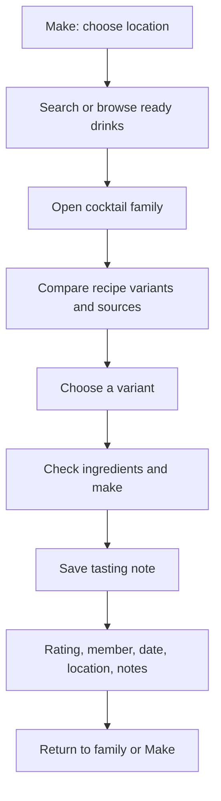
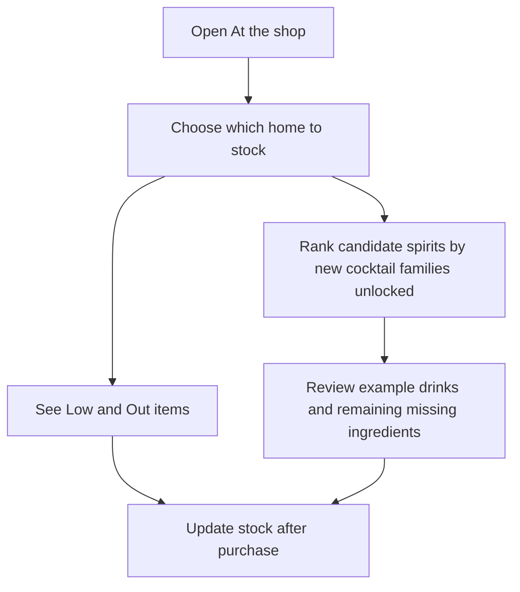
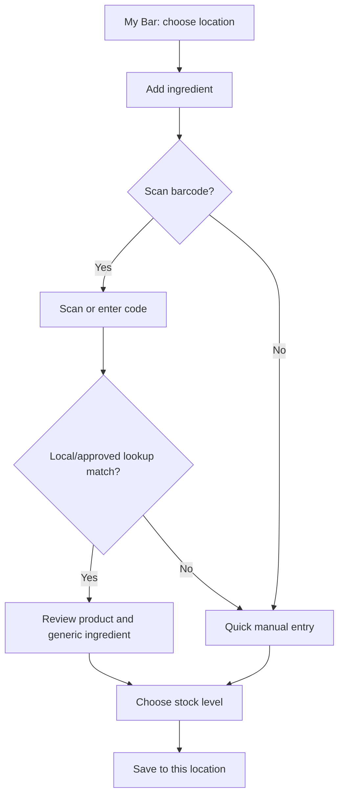
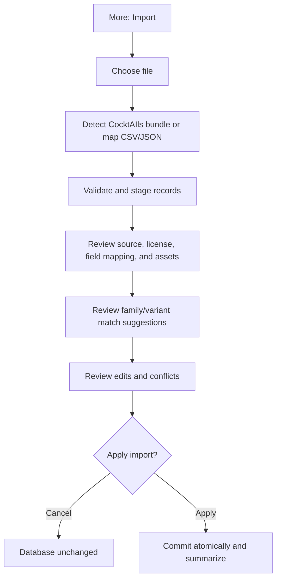

# Navigation and key flows

## Main navigation

Use four top-level destinations on phones:

- **Make:** location-aware suggestions, exact matches, near matches, favorites, and recent drinks.
- **My Bar:** selected location and its inventory; quick add and barcode scan.
- **Recipes:** searchable cocktail-family catalog, household recipes, and variants.
- **More:** household members, import/export, assistant provider settings, preferences, and data/source acknowledgements.

Keep the active location visible in Make and My Bar. With the user's opt-in, check foreground device location against user-configured, device-local home areas. A clear manual override remains available until the user returns to automatic mode. Without permission, a confident match, or when Shop mode is active, use the current/last explicit home and ask if needed; never silently select an arbitrary location. The app opens directly into the last useful place; do not require account setup.

## Find, make, and review a drink

The user can reach the same family from Recipes search. “Missing one/two” results must identify the missing items and must not imply the drink is makeable as written.

## At the shop

Shop mode uses the selected household pantry even when the phone is physically at a store. It pauses automatic home switching. “New drinks” counts distinct cocktail families that become fully makeable after adding the candidate spirit; at least one variant must have no other missing required ingredient, and multiple variants count once. Explain the calculation and keep restock suggestions separate from new-spirit unlocks. The view works offline.

## Add an ingredient to a location

An existing household barcode match is shown locally first. Open Food Facts lookup is an explicit optional action and only sends the barcode when the local source cache has no result. Returned name, brand, and quantity remain a separate attributed suggestion; they are not copied into household fields or backups. Unknown barcode or lookup failure never blocks manual entry. See [ADR-0011](../architecture/ADR-0011-optional-open-food-facts-lookup.md).

## Import a source or household file

Show likely recipe-family/variant matches as suggestions with reasons. The user can keep a record separate, link it to an existing family/variant, or create a new family. Persist confirmed source-ID mappings for repeat imports.

## Assistant request

The assistant is reachable from Make and recipe creation, with the active location preselected. Show the selected provider (local or named cloud provider) and a concise preview of the data being sent before the first cloud request. Suggestions are drafts; save only after review.
